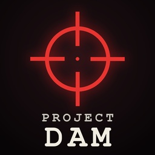

<p align="center">
  
</p>

<h1 align="center">Project Dam</h1>

> An opinionated fork of the [GoldenEye 007 PC Port](https://github.com/jkdansereau/goldeneye-pc-port)
> by [James Dansereau](https://github.com/jkdansereau) and its contributors,
> aimed first at the Nintendo Switch, and still built for PC.

**Project Dam runs GoldenEye 007 (1997) natively on the Nintendo Switch, as
homebrew, and on Windows and Linux.** It is not an emulator: the game is
compiled from the [GoldenEye 007 decompilation](https://github.com/n64decomp/007)
and runs from your own ROM. The game itself, its fixes and its options are the
upstream PC port's work. This fork compiles it for the console (devkitA64,
libnx) and adds what the Switch needs: the N64 address window under Horizon,
fullscreen at 1080p docked and 720p handheld, the Nintendo button layout, finer
aim for the Joy-Con stick, and a clean return to the HOME menu. It also makes
its own choices (hence "opinionated"): visual improvements such as the GE+ sky
and anti-aliasing, co-op, and aim helpers, grouped under a Display mode of
**Enhanced**, **Original** or **Custom**. Original gives you the game's own
picture back. It is unofficial and ships no game content: you need your own US
ROM.

- **Download (Switch only for now):** [latest release](../../releases/latest); the archive's
  `README.txt` has the install steps.
- **Changes:** [CHANGELOG.md](CHANGELOG.md) for this fork; the game's own
  changes are in [upstream's releases](https://github.com/jkdansereau/goldeneye-pc-port/releases).
- **Build:** [Building from source](#building-from-source).
- **Bugs:** a problem in this fork belongs here; a problem you also see in the
  upstream PC port belongs [upstream](https://github.com/jkdansereau/goldeneye-pc-port/issues).

### Credits and license

- **A modified version of the GoldenEye 007 PC Port.** Project Dam is a
  modified version of the [GoldenEye 007 PC Port](https://github.com/jkdansereau/goldeneye-pc-port)
  by [James Dansereau](https://github.com/jkdansereau) and contributors, MIT
  like the original ([LICENSE](LICENSE), third-party components in
  [NOTICE](NOTICE)). This fork's changes start on 2026-11-11, from upstream
  v0.6.0, and are in the [commit history](../../commits/main), which keeps the
  original's history too.
- GoldenEye 007 is a trademark of its owners; this project is not affiliated
  with Nintendo, Rare, Microsoft or MGM.

**This repository and its downloads contain no ROM data and none of the
original game assets. You need your own GoldenEye 007 ROM (US version) to play.**

<p align="center">
  
  <br><em>Recorded in the upstream PC port: the Facility intro, the Archives, the Dam
  sniper rifle, Silo, a 2-player match and the Dam ending.</em>
</p>

## Table of contents

- [Requirements](#requirements)
- [Quick start](#quick-start)
- [Controls](#controls)
- [What this fork offers](#what-this-fork-offers)
- [FAQ](#faq)
- [Status](#status)
- [Roadmap](#roadmap)
- [Building from source](#building-from-source)
- [Documentation](#documentation)
- [Contributing and forking](#contributing-and-forking)
- [Credits](#credits)
- [Legal](#legal)

## Requirements

- **Nintendo Switch:** a console running custom firmware with the homebrew
  menu. Launch through title takeover (hold R while starting a game), not from
  the album applet: the game needs the full application memory.
- **Windows and Linux (PC):** 64-bit x86. No PC release yet: build from source
  (see below). The renderer is Vulkan, with OpenGL 3.0 as the fallback.
- **Input:** Switch controllers; on PC, keyboard and mouse or an
  SDL-supported controller. Split-screen and co-op need one controller per
  player.
- **A ROM:** GoldenEye 007, US (NTSC-U) version, big-endian `.z64`
  ([check your ROM](docs/user-guide.md#whats-a-rom)).

## Quick start

**Switch**

1. Copy the `switch/` folder of the release archive to the root of the SD card.
2. Copy your ROM to `switch/project-dam/data/ge007.ntsc-final.z64`.
3. Start **Project Dam** from the homebrew menu. The first launch converts the
   ROM, with a progress bar (a few seconds); later launches skip it. Press A
   when it is done.

Settings, saves and logs live in `switch/project-dam/data/`.

**PC**

1. Build the game ([Building from source](#building-from-source)).
2. Put your ROM in a `data/` folder next to the executable as
   `ge007.ntsc-final.z64`.
3. Launch it. The first start converts the ROM by itself, as on the Switch.
4. **F10** (controller: **Select**) opens the options menu.

## Controls

| Action              | Keyboard / mouse         | Controller    |
|---------------------|--------------------------|---------------|
| Move / strafe       | `W` `A` `S` `D`           | Left stick (or D-pad) |
| Move / turn         | Arrow keys               | -             |
| Aim / look          | Mouse                    | Right stick   |
| Fire                | Left mouse               | Right trigger |
| Aim mode            | Right mouse / `LShift`   | Left trigger / LB |
| Use / interact      | `E`                       | A             |
| Reload              | `R`                       | X             |
| Crouch (toggles)    | `LCtrl`                   | Left or right stick click |
| Cycle owned gadgets | Watch inventory          | B             |
| Next weapon         | Mouse wheel down / `Q`   | Y             |
| Previous weapon     | Mouse wheel up           | -             |
| Start               | `Enter` / `Tab`          | Start         |
| Options menu        | `F10`                    | Select        |

The table uses Xbox-style labels; on the Switch the buttons follow the labels
printed on the controller, and the options menu shows every binding.
Everything is rebindable in the options menu. Rare's Xbox control styles are
presets, and the **Original** control style turns your pad into an N64
controller. The [user guide](docs/user-guide.md#controls) covers control
styles, rebinding and split-screen.

## What this fork offers

- **Real 60 fps, not a speed hack.** The game's logic counts time in 60 Hz
  ticks. On the N64 it only drew a frame every 2-3 ticks (20-30 fps); here it
  draws every tick, so you get 60 fps with the game, physics and AI running at
  the N64's own speed. The few spots that behaved differently at one tick per
  frame are fixed to match the N64.
- **Aiming that doesn't feel floaty.** *Aim style* picks the behavior.
  **Centered** pins the crosshair in the middle and the stick (or mouse) turns
  the camera directly, like a modern shooter. **Original** keeps the N64's
  crosshair that moves a little before the camera follows. Both sticks have
  their own sensitivity, deadzone and smoothing; on the Switch, aim zoom and
  aim assist make a head big enough to hit on the handheld screen.
- **Dual analog built in.** No emulator remapping: the right stick looks, the
  triggers fire and aim, and every button is rebindable. Rare's Xbox control
  styles are presets, and the **Original** control style turns the pad into a
  strict virtual N64 controller.
- **The whole game.** All 20 solo missions and the credits, every difficulty,
  007 mode and the cheats, plus split-screen multiplayer for up to 4 players.
  **Co-op** runs a solo mission for two to four players in split screen, with
  revive and friendly fire (Switch and PC).
- **Display mode: Enhanced, Original or Custom.** Enhanced adds this fork's
  visual improvements, such as the GE+ sky and sea, corrected display flaws and
  anti-aliasing (MSAA, FXAA). **Original** is the game's own picture. Custom
  exposes the individual options: aspect, widescreen, VSync, frame cap,
  texture filter, anisotropy, and draw, fog and LOD distance.
- **Faithful logic.** It is the game's own reconstructed source compiled
  natively, so levels, guards and weapons behave the way the N64 cartridge
  does. The few changes to game code keep N64 behavior where the platform would
  otherwise differ, or are opt-in extras.
- **Switch and PC from one source.** Switch is the main target and is
  what the releases ship; Windows and Linux builds come from the same code.

Bots, online play, mod support and PAL/JP ROMs are not available. The
[user guide](docs/user-guide.md#feature-list) has the full feature list.

## FAQ

**Is this an emulator?**
No. The game's code is compiled natively for the console or PC, the same way
the Perfect Dark PC port works. The N64 hardware is replaced by a small port
layer.

**Do I need the game?**
Yes. You need a ROM of the US (NTSC-U) version, dumped from a cartridge you own.

**Does it play like the original?**
Yes. Levels, guards and weapons run on the game's own logic at its original
speed. The **Original** display mode and the **Original** control style give
you the N64 picture and controls whenever you want them.

**Does it run on the Steam Deck or macOS?**
Not tested in this fork. The [upstream port](https://github.com/jkdansereau/goldeneye-pc-port)
targets both.

**Is there online play, bots or mod support?**
No.

**Can I use HD textures?**
No.

**How is this different from the XBLA recompilation projects?**
Those projects statically recompile the unreleased Xbox 360 remaster, a
separate version of the game. This project ports the original N64 game from
its source code. See [About the project](docs/about.md#how-this-differs-from-the-other-goldeneye-pc-projects).

**Can I keep my saves?**
Yes. Your progress is a plain file, `ge007.eep`, in the `data/` folder (on the
Switch, `switch/project-dam/data/`). Saves from 1964 or Project64 load
directly (see [using an emulator save](docs/user-guide.md#using-an-emulator-save)).

**Was AI used to build it?**
Yes. The upstream port was developed with AI coding agents directed by one
maintainer, and this fork's changes are made with Claude Code.
[How it was made](docs/about.md#how-it-was-made) has the upstream story.

**Something went wrong.**
See [Troubleshooting](docs/user-guide.md#troubleshooting), or
[open an issue](../../issues/new/choose) with `ge007.log` (and
`ge007-crash.log` after a crash) and your console or OS and GPU. Never attach
the ROM.

## Status

Project Dam is pre-1.0 and changes between versions: see the
[CHANGELOG](CHANGELOG.md) for what is in the next release and what each one
changed. The Switch is the primary target and is tested on Ryujinx and on a
console; the PC build compiles and runs but is not released yet: PC releases will
come once the PC rendering is where it should be.
Known issues are in the [known-issues table](docs/ROADMAP.md#known-issues).

## Roadmap

Open work is tracked in [`docs/ROADMAP.md`](docs/ROADMAP.md). If something
matters to you, open an issue; it helps prioritize.

## Building from source

No ROM is needed to build: the game reads yours at run time. All three targets
build in Docker:

```sh
docker compose build                    # once: devkitA64 + Linux host libs
docker compose run --rm switch          # -> build-switch/ge007.aarch64.nro
docker compose run --rm linux           # -> build-linux/ge007.x86_64
docker compose build windows            # once: MinGW-w64
docker compose run --rm windows         # -> build-win/ge007.x86_64.exe + DLLs
```

A native Windows build from the MSYS2 MINGW64 shell (`./build-pc.sh ntsc-final`)
also works. [`docs/building.md`](docs/building.md) has the details, the SD-card
layout and the nxlink test builds, and
[`docs/switch/address-model.md`](docs/switch/address-model.md) the Switch
address model.

## Documentation

The docs below are the upstream port's, adapted where this fork differs; the
upstream site (<https://jkdansereau.github.io/goldeneye-pc-port/>) shows the
unmodified PC port.

| Doc | What's in it |
|---|---|
| [User guide](docs/user-guide.md) | Controls, settings and files, ROM check, macOS setup, updating, emulator saves, troubleshooting. |
| [About the project](docs/about.md) | Release history, testing status, how it was made, how it works. |
| [Roadmap](docs/ROADMAP.md) | Open work and the known-issues table. |
| [Building](docs/building.md) | Full build guide, and the ROM conversion. |
| [Internals](docs/internals.md) | Architecture and the software RSP. |
| [Porting notes](docs/porting-notes.md) | The recurring N64-to-PC bug classes, with fixes. |
| [Security](docs/security.md) and [Fidelity](docs/fidelity.md) | What a release installs, and how closely it tracks the original game's logic. |
| [`docs/dev/`](docs/dev/) | The engineering record: the finding log and development process. |

## Contributing and forking

Issues and pull requests are welcome, and so are forks: the port layer, build
system and `tools_pc/` are MIT-licensed and exist to be extended. Read
[`CONTRIBUTING.md`](CONTRIBUTING.md) first: it has the ground rules that keep
the port faithful, what to check before a pull request, and what a fork is
asked to keep.

## Credits

This port is a thin layer on a large amount of other people's work.

**Prior work it is built on**

- The [GoldenEye 007 decompilation](https://github.com/n64decomp/007), years of
  effort by Larry Ficken ("kholdfuzion") and the project's contributors; plus
  zoinkity's GoldenEye documentation, which the decomp started from. This port
  is a fork of that repository.
- The [Perfect Dark PC port](https://github.com/fgsfdsfgs/perfect_dark)
  (Ryan Dwyer and contributors), the reference architecture for this port and
  the source of the `fast3d` software RSP.
- The [Perfect Dark decompilation](https://github.com/n64decomp/perfect_dark),
  the sibling decomp the PD port is built on.
- **Carnivorous**: author of the *Mouse Injector* input plugin for 1964 (the
  "GEPD Edition" bundle). Its mouse-aim behaviour for GoldenEye/Perfect Dark is
  what the in-game GEPD-style aim mode is modelled on; the implementation here
  is an independent reimplementation of that behaviour, not derived code.
  Thanks also to **Rice** and **schibo** of the 1964 team for the emulator it
  shipped with.

**Vendored / adapted code**

- `port/fast3d/`: the software RSP, adapted from the PD port. It originates
  with the [Ship of Harkinian](https://github.com/HarbourMasters) /
  libultraship fast3d (© Emill, MaikelChan; MIT, see `port/fast3d/LICENSE.txt`),
  which itself descends from
  [sm64-port](https://github.com/sm64-port/sm64-port)'s fast3d and audio mixer.
- `port/fast3d/glad/`: OpenGL loader generated by
  [glad](https://github.com/Dav1dde/glad) (David Herberth, MIT).
- The decompilation toolchain: [`ido-static-recomp`](https://github.com/decompals/ido-static-recomp)
  (Emill / decompals), [`qemu-irix`](https://github.com/n64decomp/qemu-irix) and
  `rabbitizer` (n64decomp).
- [SDL2](https://libsdl.org) and [zlib](https://zlib.net).
- [Dear ImGui](https://github.com/ocornut/imgui) (Omar Cornut and contributors, MIT),
  which draws the options menu (`port/third_party/imgui/`).
- The options menu's fonts: [Barlow Condensed](https://github.com/jpt/barlow) (The Barlow
  Project Authors) and [Fira Sans](https://github.com/mozilla/Fira) (The Mozilla
  Foundation and Telefonica S.A.), both under the SIL Open Font License
  (`port/third_party/fonts/`).
- The options menu's gamepad drawing: "Generic Gamepad Template" by nicefrog, from
  [OpenGameArt](https://opengameart.org/content/generic-gamepad-template), CC0
  (`port/third_party/gamepad/`).

**Methodology**

- Chris Lewis, [*"Decompiling a Nintendo 64 Game in 84 Days"*](https://blog.chrislewis.au/decompiling-a-nintendo-64-game-in-84-days/) (the Snowboard
  Kids decompilation write-up), the agent-workflow practices in
  [`docs/dev-process.md`](docs/dev-process.md) are adapted from it.

**Contributors**

- **dolent** (#120, #121, #122, #123), **italoarruda** (#106, #107, #108, #109),
  **danturn** (#95 macOS, #96), **Julio C. Rocha** (#88 macOS Intel groundwork),
  **f1zz1ec0ke** (#137 frame interpolation), **JosephAHK** (#133), and
  **MST246** (the #125 investigation), plus everyone who filed issues.

**Consultation**

- **f1zz1ec0ke** ([GitHub](https://github.com/f1zz1ec0ke)): LLM consultation on model
  tuning, agent harnesses, and agentic strategy throughout the port's development
  (and the author of the #137 frame-interpolation design noted above).

The models and tools used to develop the port are listed in
[About the project](docs/about.md#tools-and-models-used-to-develop-the-port).

## Legal

This is a non-commercial fan preservation/research project, in the same
category as the many other N64 decompilation and native-port repositories on
GitHub. It is **not affiliated with, endorsed by, or sponsored by** Nintendo,
Rare, Microsoft, Valve, Apple, MGM, Danjaq, EON Productions, or any rights holder in
GoldenEye or James Bond. "GoldenEye 007", "007", "James Bond" and related
marks belong to their respective owners; they are used here only to say which
game this port runs. No official logos, box art, or marketing assets are used.

### What the download contains

- **The engine:** the `port/` layer plus the compiled decompilation.
- **Runtime libraries:** SDL2 (and SDL3 on macOS) and zlib under the zlib
  license, the MinGW runtime on Windows, and the GCC C++ runtime on macOS
  (GPL-3.0 with the GCC Runtime Library Exception); their licenses travel in
  the download.
- **The ROM converter**, built into the game, which reads your ROM on your machine.

It contains **no ROM and no game assets of any kind**. Any build, yours or a
release, is useless without a ROM you supply.

### What happens on your computer

Textures, audio, models, level data and in-game text are extracted from a ROM
*you already own*, on *your* machine, the first time you start the game. The
port has no network access unless you turn on the opt-in *Check for updates* option (`Game.CheckUpdates`, off by default). When on, it makes one HTTPS request per launch to GitHub's releases API to look for a newer Project Dam release (GitHub sees the request and your IP, as with any web request) and never uploads anything. On the PC it only tells you and opens the release notes. On the Switch, "Update available" in the menu can also download the new `project-dam.nro`, check its sha256 against the one GitHub lists, and replace the running NRO, only when you choose it and only with at least 5% battery or on the charger.

### This repository

The repository is a fork of the public
[GoldenEye 007 decompilation](https://github.com/n64decomp/007) and inherits
its contents (see [`NOTICE`](NOTICE) for what that includes). The few
port-specific edits inside the decompiled code are marked `#ifdef PORT`.

The project mark / favicon is original *generated* art -- a generic version
of the game's default aim cross (a circle with N/S/E/W lines crossing its
edge), no game screenshots or logos in it.

### Your part

- Only use a ROM that you dumped from a cartridge you own.
- Never ask for, link to or share ROMs or extracted game files in issues,
  discussions or pull requests.

If you are a rights holder with a concern, open an issue and it will be
addressed.

## License

The original work in this repository, the port layer (`port/`), the PC build
system, `tools_pc/`, and the documentation, is released under the MIT License;
see [`LICENSE`](LICENSE). Everything inherited from the upstream decompilation
is covered by [`NOTICE`](NOTICE), not by that license.

---

*Fork of upstream v0.6.0 · <a href="../../releases">Releases</a> · <a href="CHANGELOG.md">Changelog</a>*
